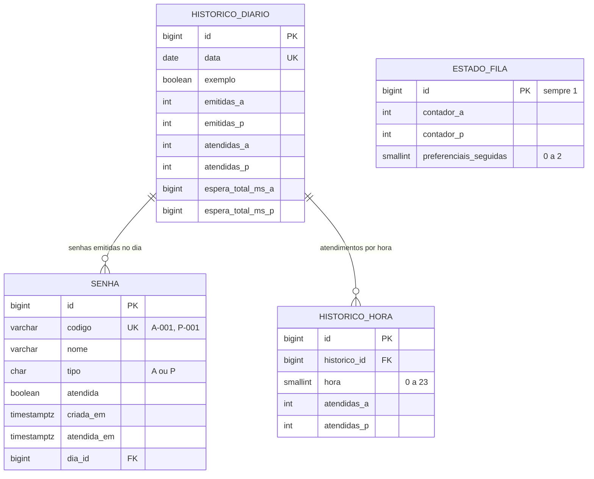

# Etapa 07 — Persistência e CRUD com Banco de Dados

A API da etapa 06 passa a gravar tudo em um banco **PostgreSQL**. Os dados sobrevivem a
reinicializações do servidor e os endpoints continuam os mesmos (a única adição é o campo `data`
em cada senha). O código fica em `api/`.

---

## 1. Escolha do banco: PostgreSQL

| Critério | Por que o PostgreSQL atende |
|----------|-----------------------------|
| **Dados relacionais** | Senhas pertencem a um dia, e cada dia tem atendimentos por hora: são entidades ligadas por chave estrangeira, o que o modelo relacional representa de forma direta. |
| **Transações (ACID)** | Emitir uma senha altera 3 coisas juntas (contador de numeração, nova senha, total do dia). Chamar a próxima também. Ou tudo é gravado, ou nada é. |
| **Concorrência** | Quiosque, painel e TV acessam ao mesmo tempo. Com `SELECT ... FOR UPDATE` a numeração não repete e duas chamadas simultâneas nunca pegam a mesma senha. |
| **Integridade no próprio banco** | `UNIQUE`, `FOREIGN KEY` e `CHECK` impedem dado inválido mesmo que alguém grave direto no banco. |
| **Relatórios** | Os relatórios são somas e médias por período, o que SQL faz bem. |

**Por que não as alternativas:** o *SQLite* não tem controle de concorrência adequado para vários
clientes simultâneos; um banco *NoSQL* (como o MongoDB) daria flexibilidade de esquema que este
domínio não precisa, e perderíamos chaves estrangeiras e restrições.

---

## 2. Arquitetura (API desacoplada do banco)

```
HTTP ──► urls.py ──► views.py ──► services.py ──► repositorio.py ──► models.py ──► PostgreSQL
        (rotas)     (entrada/     (regras da      (ÚNICO módulo     (ORM)
                    saída JSON)    fila)           que conhece o banco)
```

- `views.py` e `services.py` **não importam nada de banco**. Trabalham com as classes de `dominio.py`
  (`Senha`, `HistoricoDiario`), que são Python puro.
- `repositorio.py` é o único que usa o ORM. Ele devolve objetos de domínio e **traduz as exceções do
  banco** para erros de domínio (`BancoIndisponivel`, `ConflitoPersistencia`, `ErroPersistencia`).
- Para trocar de banco ou de tecnologia, só `repositorio.py` e `models.py` mudam; rotas, views,
  validações e regras de negócio ficam intactas.
- A conexão é configurada por variáveis de ambiente (`config/settings.py`), sem credenciais no código.

---

## 3. Modelo do banco



O DDL completo está em [`docs/etapa-07/schema.sql`](etapa-07/schema.sql).

---

## 4. Entidades

### `senha` — recurso principal
Uma senha emitida no quiosque.

| Coluna | Tipo | Regras |
|--------|------|--------|
| `id` | bigint | PK, gerado pelo banco |
| `codigo` | varchar(10) | **único**; `A-001` (normal) ou `P-001` (preferencial) |
| `nome` | varchar(30) | obrigatório |
| `tipo` | char(1) | `CHECK` em (`A`, `P`) |
| `atendida` | boolean | `CHECK`: `true` somente se `atendida_em` estiver preenchida |
| `criada_em` | timestamptz | obrigatório |
| `atendida_em` | timestamptz | nulo enquanto aguarda; `CHECK` ≥ `criada_em` |
| `dia_id` | bigint | **FK** → `historico_diario` (dia da emissão), `ON DELETE` protegido |

Índice `(atendida, tipo, id)` acelera a montagem da fila.

### `historico_diario`
Um registro por dia, atualizado a cada emissão e chamada; é a base do relatório.

| Coluna | Descrição |
|--------|-----------|
| `data` | **única**; o dia (fuso de São Paulo) |
| `exemplo` | `true` quando o dia veio da importação de dados de exemplo |
| `emitidas_a` / `emitidas_p` | senhas emitidas (normais / preferenciais) |
| `atendidas_a` / `atendidas_p` | senhas atendidas |
| `espera_total_ms_a` / `_p` | **soma** dos tempos de espera; a média é calculada na consulta (soma ÷ atendidas), o que mantém a média correta ao agrupar vários dias |

Todas as contagens têm `CHECK >= 0`.

### `historico_hora`
Atendimentos por hora cheia de cada dia.

| Coluna | Descrição |
|--------|-----------|
| `historico_id` | **FK** → `historico_diario` (`ON DELETE CASCADE` na aplicação) |
| `hora` | `CHECK` entre 0 e 23; **única** junto com `historico_id` |
| `atendidas_a` / `atendidas_p` | atendimentos naquela hora |

### `estado_fila`
Linha única (`id = 1`) com a numeração (`contador_a`, `contador_p`) e `preferenciais_seguidas`
(`CHECK` ≤ 2), usada na regra de 2 preferenciais para cada 1 normal. É a linha bloqueada com
`SELECT ... FOR UPDATE` nas operações concorrentes.

---

## 5. Relacionamentos

| Relação | Cardinalidade | Significado |
|---------|---------------|-------------|
| `historico_diario` → `senha` | 1 : N | cada senha pertence ao dia em que foi emitida. Um dia que já tem senhas **não pode ser apagado** (`PROTECT`) |
| `historico_diario` → `historico_hora` | 1 : N | cada dia tem até 24 linhas de atendimentos por hora. Apagar o dia apaga suas horas |

`estado_fila` não se relaciona com outras tabelas: é só o controle da fila.

Exemplo de consulta que usa a relação:

```sql
SELECT d.data, s.codigo, s.nome, s.atendida
FROM senha s JOIN historico_diario d ON d.id = s.dia_id
WHERE d.data = '2026-11-23' ORDER BY s.id;
```

---

## 6. Criação do banco e execução

### Opção A — Docker (mais simples)

```bash
cd api
docker compose up -d                       # PostgreSQL 16 com banco/usuário/senha "fila"
python -m venv .venv && source .venv/bin/activate     # Windows: .venv\Scripts\activate
pip install -r requirements.txt
python manage.py migrate                   # cria as tabelas
python manage.py runserver 8001
```

### Opção B — PostgreSQL instalado na máquina

```bash
psql -U postgres -c "CREATE USER fila WITH PASSWORD 'fila';"
psql -U postgres -c "CREATE DATABASE fila OWNER fila;"
cd api && pip install -r requirements.txt
python manage.py migrate
python manage.py runserver 8001
```

As tabelas podem ser criadas também só com SQL: `psql -U fila -d fila -f docs/etapa-07/schema.sql`
(nesse caso, não rode `migrate` no mesmo banco).

### Configuração (variáveis de ambiente)

| Variável | Padrão |
|----------|--------|
| `DB_NAME` | `fila` |
| `DB_USER` | `fila` |
| `DB_PASSWORD` | `fila` |
| `DB_HOST` | `127.0.0.1` |
| `DB_PORT` | `5432` |
| `DB_CONNECT_TIMEOUT` | `5` (segundos) |

Para zerar os dados: `python manage.py flush --no-input` (ou `docker compose down -v`).

---

## 7. Validações

As regras valem em três camadas, de modo que um dado inválido não entra mesmo se uma camada falhar:

1. **API** (`validators.py`, resposta `400`): `nome` com 3 a 30 letras minúsculas, `tipo` `"A"`/`"P"`,
   ID numérico, datas `AAAA-MM-DD`, filtros válidos.
2. **Regras de negócio** (`views.py`/`services.py`): senha já atendida não pode ser alterada (`409`);
   o tipo não pode ser mudado depois da emissão.
3. **Banco** (restrições): `UNIQUE` em `senha.codigo` e `historico_diario.data`, `FOREIGN KEY`, e os
   `CHECK` descritos na seção 4. Testado gravando direto no banco: um `tipo = 'Z'` ou um `codigo`
   repetido são recusados pelo PostgreSQL.

---

## 8. Tratamento de erros de persistência

Qualquer falha do banco é capturada no `repositorio.py`, registrada no log e convertida em um erro de
domínio. A API responde com o mesmo formato JSON de erro da etapa 06, **sem expor detalhes internos**:

| Situação | Erro de domínio | HTTP | `codigo` |
|----------|-----------------|------|----------|
| Banco desligado, rede, credencial ou *timeout* | `BancoIndisponivel` | **503** | `BANCO_INDISPONIVEL` |
| Violação de unicidade, vínculo ou `CHECK` | `ConflitoPersistencia` | **409** | `CONFLITO_PERSISTENCIA` |
| Qualquer outra falha do banco | `ErroPersistencia` | **500** | `ERRO_PERSISTENCIA` |

```http
HTTP/1.1 503 Service Unavailable

{ "sucesso": false, "erro": "Banco de dados indisponível. Tente novamente em instantes.",
  "codigo": "BANCO_INDISPONIVEL" }
```

As operações que gravam em mais de uma tabela rodam em **transação**: se qualquer passo falhar, nada
é gravado. Com o banco parado, a API continua respondendo (`503`) e volta ao normal assim que o
banco volta, sem reiniciar o servidor.

---

## 9. Exemplos de operações CRUD

Os endpoints e a coleção Postman (`docs/etapa-06/fila-api.postman_collection.json`) são os mesmos da
etapa 06 e funcionam sem alterações. Base: `http://127.0.0.1:8001/api`.

### Create — `POST /api/senhas/`

```bash
curl -i -X POST http://127.0.0.1:8001/api/senhas/ \
  -H "Content-Type: application/json" -d '{"nome": "ana", "tipo": "A"}'
```

```http
HTTP/1.1 201 Created
Location: /api/senhas/1/

{ "id": 1, "codigo": "A-001", "nome": "ana", "tipo": "A", "tipo_descricao": "normal",
  "data": "2026-11-23", "atendida": false,
  "criada_em": "2026-11-23T16:05:17.402113-03:00", "atendida_em": null, "espera_ms": null }
```

Efeito no banco (numa única transação): `estado_fila.contador_a` +1, nova linha em `senha` e
`historico_diario.emitidas_a` +1.

### Read — `GET /api/senhas/` e `GET /api/senhas/1/`

```bash
curl "http://127.0.0.1:8001/api/senhas/?tipo=P&atendida=false"
curl http://127.0.0.1:8001/api/senhas/1/
```

```json
{ "total": 1, "dados": [ { "id": 3, "codigo": "P-001", "nome": "caio", "tipo": "P",
  "tipo_descricao": "preferencial", "data": "2026-11-23", "atendida": false,
  "criada_em": "2026-11-23T16:05:17.440812-03:00", "atendida_em": null, "espera_ms": null } ] }
```

ID inexistente → `404` `SENHA_NAO_ENCONTRADA`; ID não numérico → `400` `ID_INVALIDO`.

### Update — `PATCH /api/senhas/1/` (ou `PUT`, que exige `nome`)

```bash
curl -X PATCH http://127.0.0.1:8001/api/senhas/1/ \
  -H "Content-Type: application/json" -d '{"nome": "beatriz"}'
```

```http
HTTP/1.1 200 OK

{ "id": 1, "codigo": "A-001", "nome": "beatriz", "tipo": "A", "...": "..." }
```

Senha já atendida → `409` `SENHA_JA_ATENDIDA`; tentar mudar o `tipo` → `400`.

### Delete — `DELETE /api/senhas/1/`

```http
HTTP/1.1 204 No Content
```

Repetir a chamada → `404`. O histórico diário não é alterado pela exclusão.

### Persistência entre reinicializações

```bash
curl -X POST http://127.0.0.1:8001/api/senhas/ -H "Content-Type: application/json" -d '{"nome":"ana","tipo":"A"}'
# pare e suba o servidor de novo (Ctrl+C, depois runserver)
curl "http://127.0.0.1:8001/api/senhas/?atendida=false"     # a senha continua lá
curl -X POST http://127.0.0.1:8001/api/senhas/ -H "Content-Type: application/json" -d '{"nome":"bia","tipo":"A"}'
# -> codigo "A-002": a numeração também é persistida
```

### Consulta com agregação — `GET /api/relatorios/`

Lê `historico_diario` e `historico_hora` (ver formato de resposta na etapa 06). Para ter dados de
exemplo: `POST /api/relatorios/importacao/` com o conteúdo de `src/data/historico-exemplo.json` e,
depois, `DELETE /api/relatorios/exemplos/`.

---

## 10. Observação

As telas em `src/` continuam usando o serviço simulado da etapa 05; esta etapa trata somente da API
e do banco.
